# System Architecture: SupeRR Selector Season 2

## 1. Single Modular Monolith Architecture

The platform is designed as a **Single Modular Monolith Backend** communicating with a **FastAPI Gateway** and an interactive **React Dashboard Client**, enforcing strict boundary isolation, domain encapsulation, and pipeline-oriented execution.

```mermaid
flowchart LR
    subgraph Client ["Client Layer"]
        React["React Dashboard\n(Port 5173)"]
    end

    subgraph Gateway ["API Interface"]
        FastAPI["FastAPI REST API\n(Port 8000)"]
    end

    subgraph Monolith ["Single Modular Monolith Backend"]
        direction LR
        M1["Data Engineering\nModule"] --> M2["Pressure\nModule"]
        M2 --> M3["Feature Engineering\nModule"]
        M3 --> M4["ML Prediction\nModule"]
        M4 --> M5["Bayesian Reliability\nModule"]
        M5 --> M6["Monte Carlo\nModule"]
        M6 --> M7["Decision Ranking\nModule"]
    end

    React <-->|HTTP / JSON| FastAPI
    FastAPI <-->|Service Invocations| Monolith

    classDef client fill:#1e293b,stroke:#ec4899,stroke-width:2px,color:#fff;
    classDef api fill:#0f172a,stroke:#3b82f6,stroke-width:2px,color:#fff;
    classDef module fill:#131c31,stroke:#2563eb,stroke-width:2px,color:#fff;
    classDef container fill:#090d16,stroke:#334155,stroke-width:1px,color:#94a3b8;

    class React client;
    class FastAPI api;
    class M1,M2,M3,M4,M5,M6,M7 module;
    class Monolith container;
```

---

## 2. The 7 Sequential Modules of the Backend

### Module 1: Data Engineering Module
* **Location**: `src/suprr_selector/modules/data_engineering/`
* **Responsibilities**:
  * Ingests 6 raw CSV files (200,999 deliveries, 883 matches, 141 competitions).
  * Validates schema types, checks key uniqueness, and flags missing values.
  * Reconstructs physical match delivery sequences, legal ball counting, and boundary flags.
  * Maps canonical player IDs (`competition_team_player_mapping.csv`).

### Module 2: Pressure Module (Intelligence Engine)
* **Location**: `src/suprr_selector/modules/pressure_intelligence/`
* **Responsibilities**:
  * Evaluates delivery-level match constraints dynamically.
  * **2nd Innings (Chase)**: Evaluates Required Run Rate ($RRR$), Balls Remaining ($B_{\text{rem}}$), Wickets in Hand ($W_{\text{in\_hand}}$), and Death Leverage.
  * **1st Innings (Par Setting)**: Detects Powerplay collapses ($\ge 3$ wickets down in overs 1-6) and Death-Overs run maximization.
  * Outputs continuous Pressure Index ($PI \in [0.0, 1.0]$) and isolates the top 19.8% ($PI \ge 0.60$) high-pressure crucible.

### Module 3: Feature Engineering Module
* **Location**: `src/suprr_selector/modules/feature_engineering/`
* **Responsibilities**:
  * Constructs rolling historical baselines strictly using prior matches (zero future data leakage).
  * Computes role-aware features: batter dot-ball resistance, boundary frequency, bowler economy suppression, and dot-ball generation.
  * Formulates relative delta metrics: $\Delta\text{SR} = \text{SR}_{\text{HP}} - \text{SR}_{\text{Baseline}}$, $\Delta\text{Econ} = \text{Econ}_{\text{Baseline}} - \text{Econ}_{\text{HP}}$.

### Module 4: ML Prediction Module
* **Location**: `src/suprr_selector/modules/predictive_modeling/`
* **Responsibilities**:
  * Trains multi-class outcome models (LightGBM / Gradient Boosting) on ball-by-ball states.
  * Predicts categorical ball outcomes: dot, 1, 2, 3, 4, 6, wicket, wide, no-ball.
  * Employs match-level chronological splitting (2022–24 Train, 2025 Val, 2026 Test) to prevent autocorrelation leakage.

### Module 5: Bayesian Reliability Module
* **Location**: `src/suprr_selector/modules/bayesian_reliability/`
* **Responsibilities**:
  * Solves small-sample variance through hierarchical shrinkage:
    $$\theta_i \sim \mathcal{N}(\mu_{\text{role}}, \tau^2_{\text{role}})$$
  * Shrinks noisy, low-sample performances toward population priors while allowing large-sample evidence to dominate.
  * Generates 95% posterior credible intervals and Top 10 membership probabilities.

### Module 6: Monte Carlo Module
* **Location**: `src/suprr_selector/modules/monte_carlo_simulation/`
* **Responsibilities**:
  * Runs 2,500 to 10,000 dynamic, state-dependent simulation iterations per scenario.
  * Simulates delivery-by-delivery, updating the cricket state machine (wickets, runs, overs remaining) after every sampled outcome.
  * Generates empirical win probability distributions, expected runs, and dismissal likelihoods under standardized pressure presets.

### Module 7: Decision Ranking Module
* **Location**: `src/suprr_selector/modules/decision_ranking/`
* **Responsibilities**:
  * Computes composite rankings:
    * **Batting Clutch Index (BCI)**: Weighted by $\text{SR}_{\text{HP}}$, $\text{Avg}_{\text{HP}}$, $\Delta\text{SR}$, and volume reliability.
    * **Bowling Clutch Index (BoCI)**: Weighted by $\text{Econ}_{\text{HP}}$, $\text{SR}_{\text{HP}}$, $\Delta\text{Econ}$, and dot-ball generation.
  * Enforces qualification thresholds ($\ge 120$ HP balls for batters; $\ge 150$ HP balls for bowlers).
  * Outputs the definitive 1-to-10 ordered lists for Unstop submission.

---

## 3. Communication & Integration Flow

1. **Client / Gateway**: The **React Dashboard** makes asynchronous REST requests to the **FastAPI Gateway** (`/api/rankings`, `/api/simulation/run`, `/api/pressure/evaluate`).
2. **Backend Monolith Execution**: FastAPI routes invoke the application use cases, which orchestrate the 7 domain modules in sequence.
3. **Decoupled Deployment**: The frontend can run standalone with cached precomputations or communicate live with the backend service.
