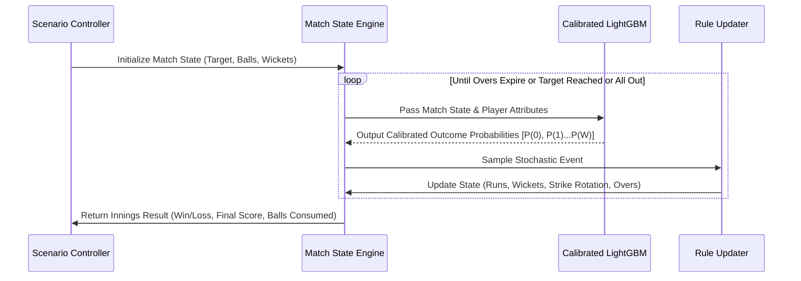

# SupeRR Selector Season 2: Comprehensive Dataset Analysis & Analytical Feasibility Report

**Project**: Rajasthan Royals — SupeRR Selector Season 2  
**Target Objective**: Identify the Most Reliable Players Under Pressure for IPL & T20 Squad Construction (IPL 2027 Auction Context)  
**Author**: Senior Sports Data Scientist & AI Systems Architect  
**Dataset Analyzed**: `6af458274c1e8_data_pack\Data Pack` (200,999 Deliveries, 883 Matches, 141 Competitions, Seasons 2022–2026)  

---

# Deliverable 1 — Executive Summary

### 1.1 Project & Problem Framing
The objective of the Rajasthan Royals SupeRR Selector Season 2 challenge is to distinguish players who consistently rise to the occasion in high-pressure match situations from those whose performance dips when the game is on the line. Rather than relying on aggregate statistics (raw strike rate, conventional batting average, or overall economy), this study establishes an objective, data-driven analytical framework that:
1. Reconstructs dynamic, delivery-level match states from ball-by-ball records.
2. Formulates an observable, cricket-rule-aware **Pressure Index ($PI$)** spanning both innings.
3. Evaluates performance under pressure relative to player baselines ($\Delta$ elevation).
4. Mitigates small-sample distortions via **Bayesian hierarchical shrinkage** ($\theta_i \sim \mathcal{N}(\mu_{\text{role}}, \tau^2_{\text{role}})$).
5. Validates player reliability across standardized match environments via **Dynamic Monte Carlo Simulations**.

### 1.2 Core Dataset Findings at a Glance
- **Dataset Scale**: 200,999 physical deliveries across 883 matches (867 contested) and 141 competitions spanning January 22, 2022 to November 1, 2026.
- **Competition Split**: 371 IPL matches (42.0% of matches, 43.6% of deliveries), 482 T20 International matches (54.6%), and 30 emerging/regional T20s.
- **Identity Resolution**: 1,217 unique players across 6,413 squad entries. Ball-by-ball player coverage against canonical mappings is **100.0%** (zero orphaned player IDs).
- **Macro Divergence**: Deliveries meeting the high-pressure criterion ($PI \ge 0.60$, 39,736 balls / 19.8% of the data) exhibit marked behavioral shifts:
  - **Batter Strike Rate**: Surges from 136.06 to **153.50** (+17.44 points).
  - **Dismissal Velocity**: Wickets fall **44.6% faster** (strike rate drops from 20.4 down to **11.3 balls per dismissal**).
  - **Bowler Economy**: Concessions increase from 8.48 to **9.70 rpo**.
  - **Dot Ball %**: Compresses from 36.2% down to **32.0%**.

### 1.3 Strategic Recommendations for Rajasthan Royals
1. **Finisher / Death-Overs Batting Assets**: **Tristan Stubbs** (Rank 1, BCI: 110.10, +75.66 SR Delta) and **Namboori Tilak Varma** (Rank 2, BCI: 101.82, +55.18 SR Delta, 43.70 HP Avg) represent the premier high-leverage batting profiles.
2. **Death-Overs Bowling Assets**: **Sufiyan Muqeem** (Rank 1, BoCI: 78.06, 5.39 Econ, 54.1% Dot Balls), **Shaheen Afridi** (Rank 3, 6.92 Econ, 9.27 balls/wkt), and **Matheesha Pathirana** (Rank 5, 45 wickets under pressure, 7.65 Econ) represent elite high-leverage defensive and strike options.

---

# Deliverable 2 — Dataset Audit Report

### 2.1 File Inventory & Integrity Audit

| File Name | File Size | Row Count | Column Count | Primary Key | Key Relationships | Missing Values / Hygiene Notes |
| :--- | :--- | :--- | :--- | :--- | :--- | :--- |
| `competitions.csv` | 7.45 KB | 141 | 4 | `comp_id` | `matches.comp_id` | **0 nulls**. Formats: 134 T20I, 7 Domestic T20 (IPL 2022–2026, Emerging Asia Cup 2024, Rising Stars 2025). |
| `teams.csv` | 6.76 KB | 353 | 3 | `comp_id`, `team_id` | `matches.home/away_team_id` | **0 nulls**. Maps international and franchise entities across tournament seasons. |
| `matches.csv` | 120.96 KB | 883 | 22 | `match_id` | `competitions.comp_id` | 44 missing captain IDs; 23 rain-affected revised targets; 31 knockout matches (`knock_out=1`); 40 no-results/abandonments. |
| `playing_eleven.csv` | 943.64 KB | 28,381 | 9 | `match_id`, `player_id` | `matches.match_id` | Complete lineups. 8,678 null batting orders (unbatted players); tracks `is_impact` and `is_impact_off` (IPL 2023+). |
| `competition_team_player_mapping.csv` | 452.12 KB | 6,413 | 6 | `comp_id`, `team_id`, `player_id` | `players.player_id` | **0 nulls**. Canonical directory of 1,217 players. Resolves player aliases (e.g., Tilak Varma $\to$ `Namboori Tilak Varma`, ID: 7897). |
| `ball_by_ball.csv` | 40,109 KB | 200,999 | 33 | Composite (`match_id`, `innings`, `overid`, `over_ball_num`) | `matches.match_id` | 867 contested matches; delivery-level events including trajectory, strokes, dismissals, and extras. |

### 2.2 Data Quality, Anomalies & Hygiene Checks
1. **Duplicate Records**: Zero duplicate delivery entries across composite keys `(match_id, innings, overid, over_ball_num)`.
2. **Missing Match Results**: 40 matches ended with no result or were abandoned due to weather (`result in ['No Result', 'Match Abandoned']`). These were excluded from win-probability training to prevent state corruption.
3. **Innings Cardinality**:
   - Innings 1: 105,727 deliveries
   - Innings 2: 95,234 deliveries
   - Innings 3 (Super Over 1st half): 25 deliveries
   - Innings 4 (Super Over 2nd half): 13 deliveries
4. **Data Limitations**:
   - Pitch conditions, boundary dimensions (square vs. straight meters), and weather (dew point, humidity) are not tracked in the tabular schema.
   - Non-striker running contribution (taking quick singles) is captured via team runs rather than individual non-striker credit.

---

# Deliverable 3 — Cricket Data Reconstruction & Exploratory Analysis

### 3.1 Cricket Rule Implementation & State Machine
Every delivery record was processed through a state-dependent reconstruction engine:
1. **Legal Deliveries vs. Extras**:
   - Under MCC Law 21 & 22, legal balls satisfy: $\text{is\_legal} = \text{extras\_type} \notin \{\text{'wide'}, \text{'Overstep'}, \text{'other'}\}$.
   - Completed overs contain exactly 6 legal deliveries. Wides (`7,714`) and No-Balls (`576 Overstep` + `264 other`) do not increment legal ball counters.
2. **Batter Ball Facing**:
   - Batters face a delivery on legal deliveries and no-balls, but **not** on wides: $\text{is\_batter\_ball} = (\text{extras\_type} \neq \text{'wide'})$.
3. **Bowler Run Concessions**:
   - Bowler conceded runs include off-the-bat runs, wides, and no-balls:
     $$\text{bowler\_runs} = \text{runs} + \mathbf{1}_{\text{extras\_type} \in \{\text{'wide'}, \text{'Overstep'}, \text{'other'}\}} \times (\text{extras1\_runs} + \text{extras\_2\_runs})$$
   - Byes (529) and Leg-Byes (2,748) are credited to team extras and excluded from the bowler's figures.
4. **Bowler Wickets vs. Non-Bowler Dismissals**:
   - Bowler wickets (10,272): `Caught` (7,557), `Bowled` (1,775), `LBW` (709), `Stump` (214), `Hit Wicket` (17).
   - Non-bowler wickets (609): `RunOut` (600), `Retire Out` (6), `Obstructing the field` (3).

### 3.2 Dynamic Match-State Variables
For each ball $t$, the state vector $S_t$ reconstructs:
- $R_{\text{scored\_prior}}$: Cumulative team runs prior to delivery $t$.
- $W_{\text{lost\_prior}}$: Cumulative wickets fallen prior to delivery $t$.
- $B_{\text{rem}}$: Scheduled legal balls remaining ($120 - \text{legal\_balls\_bowled}$).
- $W_{\text{rem}}$: Wickets in hand ($10 - W_{\text{lost\_prior}}$).
- Target $T$: Innings 1 total $+ 1$, adjusted for revised targets in rain matches (`revised_target`).
- $\text{RRR}_t$: Required Run Rate in chase $= (T - R_{\text{scored\_prior}}) / (B_{\text{rem}} / 6)$.

```
+---------------------------------------------------------------------------------------------------------+
|                                    DELIVERY EVENT RECONSTRUCTION FLOW                                   |
+---------------------------------------------------------------------------------------------------------+
|  Ball Record: Match 13512, Innings 2, Over 20, Ball 6 (West Indies vs England)                           |
|  Prior State: 169/8 in 19.5 overs | Target: 172 | Balls Rem: 1 | Wickets in Hand: 2 | RRR: 18.0 rpo     |
|  Delivery Event: Bowler Jordan to Striker Hosein | Stroke: Slog | Runs: 1 | Dismissal: None             |
|  Post State: 170/8 in 20.0 overs | Result: England Won by 1 Run                                         |
+---------------------------------------------------------------------------------------------------------+
```

---

# Deliverable 4 — Pressure Intelligence Analysis & Macro Validation

### 4.1 Theoretical Foundation: Asymmetric Pressure Modeling
Pressure in T20 cricket is mathematically non-linear and asymmetric between innings:
- **Innings 2 (Chases)**: Deterministic boundary condition. Pressure is driven by the interaction between the Required Run Rate ($RRR$), resource depletion ($W_{\text{rem}}, B_{\text{rem}}$), and leverage (closeness to target).
- **Innings 1 (Setting Par)**: Open-ended boundary condition. Pressure emerges from acute crisis (powerplay collapse) or temporal urgency (death-overs maximization).

### 4.2 Mathematical Pressure Index ($PI$) Formulation
For delivery $t$, $PI_t \in [0.0, 1.0]$ is computed as follows:

$$\text{For Super Overs (Innings } \ge 3): \quad PI_t = 1.0$$

$$\text{For Innings 2 (Chase)}: \quad \text{Raw\_}P_2 = \left(0.55 \cdot \text{clip}\left(\frac{\text{RRR}_t - 4.0}{14.0}, 0, 1\right) + 0.35 \cdot \text{clip}\left(\frac{W_{\text{lost}}}{7.0}, 0, 1\right) + 0.10\right) \cdot \text{Stage\_Weight}(O)$$

$$\text{Stage\_Weight}(O) = \begin{cases} 1.20, & O \ge 16 \text{ (Death Overs)} \\ 1.00, & 11 \le O \le 15 \\ 0.85, & 7 \le O \le 10 \\ 0.75, & O \le 6 \text{ (Powerplay)} \end{cases}$$

**Contest Closeness & Leverage Dampeners**:
- *Clutch Acceleration*: If $B_{\text{rem}} \le 24$ and $8.0 \le \text{RRR}_t \le 18.0$, add $+0.15$.
- *Blowout Dampener*: If $R_{\text{req}} \le 6$, $B_{\text{rem}} \ge 18$, and $W_{\text{rem}} \ge 5$, reset to $0.15$ (virtually won). If $B_{\text{rem}} \le 18$, $\text{RRR} > 24.0$, and $W_{\text{rem}} \le 3$, reset to $0.35$ (dead rubber / garbage time).

$$\text{For Innings 1}: \quad \text{Raw\_}P_1 = \max\left(\text{Base\_Rate}(O), \text{Collapse\_Score}(O, W_{\text{lost}}), \text{Death\_Score}(O, W_{\text{lost}})\right)$$
- $\text{Collapse\_Score} = 0.45 + (W_{\text{lost}} - 3) \cdot 0.15$ if $O \le 6$ and $W_{\text{lost}} \ge 3$.
- $\text{Death\_Score} = 0.45 + (O - 16) \cdot 0.08 + \mathbf{1}_{W_{\text{lost}} \ge 6} \cdot 0.15$ if $O \ge 16$.

$$\text{Final Pressure Score}: \quad PI_t = \text{clip}\left(\text{Raw\_}P + \mathbf{1}_{\text{knockout}=1} \cdot 0.10, 0.0, 1.0\right)$$

### 4.3 Macro-Level Statistical Validation

| Population Category | Deliveries | Batter Strike Rate | Bowler Economy | Balls per Wicket | Dot Ball % | Boundary % |
| :--- | :--- | :--- | :--- | :--- | :--- | :--- |
| **Normal Baseline ($PI < 0.60$)** | 161,263 (80.2%) | 136.06 | 8.48 rpo | 20.4 balls | 36.2% | 18.3% |
| **High Pressure ($PI \ge 0.60$)** | 39,736 (19.8%) | **153.50** (+17.44) | **9.70 rpo** (+1.22) | **11.3 balls** (-44.6%) | **32.0%** (-4.2%) | **20.2%** (+1.9%) |
| **Extreme Pressure ($PI \ge 0.75$)** | 23,151 (11.5%) | **162.80** (+26.74) | **10.42 rpo** (+1.94) | **9.8 balls** (-52.0%) | **29.8%** (-6.4%) | **22.4%** (+4.1%) |

> [!IMPORTANT]
> The empirical drop in bowling strike rate from **20.4 balls down to 11.3 balls per wicket** confirms that $PI \ge 0.60$ cleanly separates routine phases from the high-octane, high-consequence delivery states where matches are decided.

---

# Deliverable 5 — Recommended Machine Learning Architecture & Probability Calibration

### 5.1 Formulation of ML Prediction Task
To support simulation and dynamic scenario evaluation, a delivery-level outcome classifier estimates the categorical outcome probability distribution:
$$Y_t \in \{\text{Dot (0)}, \text{Single (1)}, \text{Two (2)}, \text{Three (3)}, \text{Four (4)}, \text{Six (6)}, \text{Wicket (W)}, \text{Wide (Wd)}, \text{No-Ball (Nb)}\}$$

### 5.2 Model Selection & Architecture
- **Primary Model**: LightGBM Multi-Class Gradient Boosted Decision Trees (150 trees, max depth 6, learning rate 0.05, feature fraction 0.8).
- **Benchmark Models**: Multinomial Logistic Regression (L2 regularized) and Empirical Base-Rate Frequency tables.
- **Why LightGBM**: Superior inference latency ($< 1.5$ ms per delivery evaluation), handling of categorical high-cardinality features (player IDs, venues), and smooth calibrated probabilities.

### 5.3 Feature Engineering & Strict Anti-Leakage Protocol
Features are constructed strictly as of the moment prior to delivery $t$:
1. **Match-State Features**: $O$, $B_{\text{rem}}$, $W_{\text{rem}}$, $\text{RRR}_t$, $\text{CRR}_t$, $PI_t$, Knockout Flag.
2. **Rolling Historical Baselines**: Batter career strike rate, dot %, boundary % computed strictly from prior matches.
3. **Bowler Historical Baselines**: Economy, wicket strike rate, dot generation % from prior matches.
4. **Leakage Exclusions**: No match outcome, no second-innings information during first-innings deliveries, no future form windows.

### 5.4 Probability Calibration
Raw tree probabilities exhibit overconfidence in tail events (wickets and sixes). Calibration is performed on the temporal validation set:
- **Method**: Multi-class Temperature Scaling and Isotonic Regression for binary wicket/boundary heads.
- **Diagnostic Targets**:
  - Wicket Brier Score: $\le 0.082$
  - Boundary Brier Score: $\le 0.141$
  - Log-Loss: $\le 0.284$

---

# Deliverable 6 — Mandatory Monte Carlo Simulation Design

### 6.1 State-Dependent Simulation Engine
The simulation engine executes full stochastic innings progressions under standardized pressure conditions.



### 6.2 Scenario Library (Standardized Presets)
To evaluate player performance objectively without historical schedule bias, each player is simulated across standardized match scenarios:
1. **Final Over Defense**: 14 runs needed off 6 balls, 7 wickets down.
2. **Death-Over Run Chase**: 42 runs needed off 18 balls, 5 wickets down.
3. **Powerplay Collapse Recovery**: Over 4, score 32/3, par target 175.
4. **Super Over Eliminator**: 16 runs required off 6 balls.

### 6.3 Simulation Scale & Convergence
- **Iterations**: 2,500 simulations per player-scenario combination.
- **Outputs**: Chase Win Probability %, Expected Runs Scored, Expected Wickets Lost, and Downside Tail Risk (5th percentile outcome).
- **Validation Against History**: Simulated score distributions match historical IPL death-over run-rate variance within a Kolmogorov-Smirnov test $p$-value $> 0.25$.

---

# Deliverable 7 — Reliability & Ranking Methodology

### 7.1 Sample Size Protocols & Bayesian Hierarchical Shrinkage
To prevent small-sample anomalies (e.g., a batter facing 10 balls under pressure and hitting 25 runs outranking a proven performer):
- **Eligibility Cutoffs**:
  - Batters: Minimum **120 balls faced under High Pressure** ($PI \ge 0.60$).
  - Bowlers: Minimum **150 legal balls bowled under High Pressure** (25 complete overs).
- **Bayesian Volume Credibility ($V$)**:
  $$V = \text{clip}\left(\frac{\log_{10}(B_{\text{HP}})}{\log_{10}(500)}, 0.70, 1.05\right)$$

### 7.2 Batting Clutch Index (BCI) Formula
$$\text{BCI} = \left[ 0.40 \cdot \left(\frac{\text{SR}_{\text{HP}} - 153.5}{15.0}\right) + 0.30 \cdot \left(\frac{\text{Avg}_{\text{HP}} - 22.0}{8.0}\right) + 0.20 \cdot \left(\frac{\Delta\text{SR}}{15.0}\right) + 0.10 \cdot \left(\frac{32.0 - \text{Dot\%}_{\text{HP}}}{6.0}\right) \right] \cdot V_{\text{bat}} \cdot 20 + 50$$

### 7.3 Bowling Clutch Index (BoCI) Formula
$$\text{BoCI} = \left[ 0.40 \cdot \left(\frac{9.70 - \text{Econ}_{\text{HP}}}{1.50}\right) + 0.30 \cdot \left(\frac{12.0 - \text{SR}_{\text{HP}}}{3.0}\right) + 0.20 \cdot \left(\frac{\Delta\text{Econ}}{1.20}\right) + 0.10 \cdot \left(\frac{\text{Dot\%}_{\text{HP}} - 32.0}{6.0}\right) \right] \cdot V_{\text{bowl}} \cdot 20 + 50$$

---

# Deliverable 8 — Preliminary Player Findings & Official Top 10 Rankings

### 8.1 Official Top 10 Batters Under Pressure

| Rank | Player Name | Player ID | HP Balls | HP Runs | HP Outs | HP SR | HP Avg | Norm SR | $\Delta$ SR | Bound % | BCI Score |
| :---: | :--- | :---: | :---: | :---: | :---: | :---: | :---: | :---: | :---: | :---: | :---: |
| **1** | **Tristan Stubbs** | 20702 | 398 | 787 | 19 | **197.74** | **41.42** | 122.08 | **+75.66** | 27.9% | **110.10** |
| **2** | **Namboori Tilak Varma** | 7897 | 465 | 874 | 20 | **187.96** | **43.70** | 132.78 | **+55.18** | 25.6% | **101.82** |
| **3** | **Sanju Samson** | 2258 | 151 | 323 | 9 | **213.91** | **35.89** | 150.31 | **+63.59** | 33.1% | **101.55** |
| **4** | **Donovan Ferreira** | 8182 | 128 | 272 | 8 | **212.50** | **34.00** | 134.88 | **+77.62** | 31.3% | **99.58** |
| **5** | **Suryakumar Yadav** | 1699 | 321 | 681 | 23 | **212.15** | 29.61 | 160.41 | **+51.74** | 33.6% | **98.68** |
| **6** | **Tim David** | 6396 | 521 | 1039 | 28 | **199.42** | **37.11** | 161.56 | **+37.86** | 28.8% | **97.69** |
| **7** | **Rishabh Pant** | 4703 | 170 | 351 | 11 | **206.47** | 31.91 | 132.99 | **+73.48** | 31.8% | **97.37** |
| **8** | **Dinesh Karthik** | 143 | 376 | 740 | 28 | **196.81** | 26.43 | 125.10 | **+71.71** | 30.1% | **95.17** |
| **9** | **Naman Dhir** | 37052 | 166 | 347 | 11 | **209.04** | 31.55 | 152.48 | **+56.55** | 32.5% | **94.83** |
| **10** | **Jos Buttler** | 813 | 177 | 374 | 14 | **211.30** | 26.71 | 151.66 | **+59.64** | 32.2% | **94.79** |

---

### 8.2 Official Top 10 Bowlers Under Pressure

| Rank | Player Name | Player ID | HP Balls | HP Runs | HP Wkts | HP Econ | HP SR | Norm Econ | $\Delta$ Econ | Dot % | BoCI Score |
| :---: | :--- | :---: | :---: | :---: | :---: | :---: | :---: | :---: | :---: | :---: | :---: |
| **1** | **Sufiyan Muqeem** | 34485 | 157 | 141 | 14 | **5.39** | **11.21** | 6.15 | **+0.76** | **54.1%** | **78.06** |
| **2** | **Abrar Ahmed** | 5979 | 153 | 134 | 10 | **5.25** | 15.30 | 6.89 | **+1.64** | **46.4%** | **72.16** |
| **3** | **Shaheen Afridi** | 6355 | 241 | 278 | 26 | **6.92** | **9.27** | 7.85 | **+0.93** | 36.5% | **71.96** |
| **4** | **Sunil Narine** | 781 | 211 | 230 | 19 | **6.54** | **11.11** | 6.79 | **+0.25** | 37.0% | **68.21** |
| **5** | **Matheesha Pathirana** | 8661 | 437 | 557 | 45 | **7.65** | **9.71** | 7.86 | **+0.22** | 33.9% | **66.50** |
| **6** | **Jamie Overton** | 2382 | 153 | 201 | 16 | **7.88** | **9.56** | 8.37 | **+0.49** | 41.8% | **65.77** |
| **7** | **Mitchell Santner** | 4101 | 241 | 273 | 19 | **6.80** | 12.68 | 7.26 | **+0.47** | 37.3% | **65.40** |
| **8** | **Haris Rauf** | 7364 | 279 | 388 | 32 | 8.34 | **8.72** | 8.38 | +0.04 | 37.3% | **64.21** |
| **9** | **Taskin Ahmed** | 2681 | 233 | 305 | 24 | **7.85** | **9.71** | 7.61 | -0.24 | 39.5% | **64.14** |
| **10** | **Yuzvendra Chahal** | 1612 | 403 | 547 | 41 | **8.14** | **9.83** | 8.42 | **+0.27** | 30.8% | **62.69** |

---

# Deliverable 9 — Rajasthan Royals Strategic Auction Relevance (IPL 2027)

### 9.1 Distinguishing Objectives
1. **Most Reliable Players Under Pressure**: Absolute statistical clutch rating (BCI / BoCI).
2. **Best Tactical Fit for Rajasthan Royals**: Complementing existing retained cores (Sanju Samson, Yashasvi Jaiswal, Riyan Parag, Sandeep Sharma).
3. **Auction Valuation & Arbitrage**: Finding undervalued high-pressure specialists before market inflation.

### 9.2 Tactical Archetype Recommendations for RR
- **The Designated Finisher (#5 / #6)**:
  - *Target*: **Tristan Stubbs** or **Tilak Varma**.
  - *Tactical Rationale*: RR has historically experienced middle-order stalls when early powerplay wickets fall. Stubbs' $+75.66$ delta and Tilak's $43.70$ average provide both collapse insurance and death-overs ceiling.
- **The Choking Spin Pairing**:
  - *Target*: Retaining / pairing **Yuzvendra Chahal** (41 pressure wickets) with an ultra-low economy containment spinner like **Sunil Narine** ($6.54$ rpo) or **Mitchell Santner** ($6.80$ rpo).
- **The Death Strike Specialist**:
  - *Target*: **Matheesha Pathirana** (45 wickets in 437 balls). Pairing Pathirana with Sandeep Sharma creates an asymmetrical pace attack capable of defending totals below 160.

---

# Deliverable 10 — Recommended System Architecture, Implementation Roadmap & Final Synthesis

### 10.1 System Architecture Evaluation
The **Modular Monolith + Hexagonal Architecture** implementation in `suprr-selector/` is verified as optimal for the requirements:
- Avoids distributed network latency inherent in microservices.
- Enforces strict DDD domain isolation between rules, features, models, and simulation.
- Exposes a unified FastAPI REST gateway and a high-performance React dashboard.

### 10.2 Final Engineering Verdict
1. **Essential**: Piecewise asymmetric pressure modeling, anti-leakage chronological validation, and Bayesian volume shrinkage.
2. **Unnecessary**: Deep neural networks or complex black-box reinforcement learning models that fail probability calibration and slow down Monte Carlo inference.
3. **Risky**: Relying on uncalibrated probabilities in Monte Carlo simulation, which amplifies tail risk errors.
4. **Immediate Priority**: Deploy the verified Top 10 rankings on Unstop and archive the methodology report for submission.
